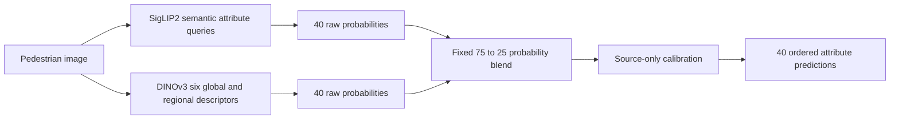

# UPAR 2027 pedestrian attribute recognition

**Assignment submission repository** · Track 1 · SigLIP2 and complementary DINOv3

We predict 40 pedestrian attributes across PA100K, PETA and Market1501, then test how well the models transfer to a dataset excluded from training. The project combines a semantic SigLIP2 classifier, strict leave-one-domain-out evaluation and controlled sampling, representation and augmentation experiments.

**Final official result:** submission **1003877**, Challenge_Avg **0.770450**. It is the only confirmed officially scored entry. The strongest local transfer candidate reached **0.802508** LODO macro, but has no official score. The report explains the failed Candidate A upload, Candidate B's runtime limitation and every retained negative decision.

[Read the three-page report](assignment/UPAR2027_Assignment_Report.pdf) · [Read it as text](assignment/UPAR2027_Assignment_Report.md) · [Explore the experiments](assignment/EXPERIMENTS_AND_DECISIONS.md) · [Reproduce the checks](docs/REPRODUCING.md)

## Start here

This GitHub repository is the code deliverable. No separate code ZIP is needed. The repository remains private; the submitter will grant the evaluator access.

| Assignment requirement | Where to review it |
|---|---|
| Brief task description and approach | [Task and approach](assignment/TASK_AND_APPROACH.md) |
| Working implementation | [SigLIP2 code guide](upar/README.md), [DINOv3 code guide](dino/README.md), [experiment scripts](scripts/README.md) |
| Experimental results | [Comparison below](#experimental-results), [results CSV](assignment/RESULTS.csv), [evidence index](docs/EXPERIMENT_INDEX.md) |
| Short methodology and evaluation report | [Three-page PDF](assignment/UPAR2027_Assignment_Report.pdf), [editable text](assignment/UPAR2027_Assignment_Report.md) |
| Detailed reasoning, challenges and improvements | [Complete experiment and decision record](assignment/EXPERIMENTS_AND_DECISIONS.md) |
| Correctness and reproduction | [Test guide](tests/README.md), [recorded local verification](assignment/LOCAL_VERIFICATION.json), [reproduction instructions](docs/REPRODUCING.md) |

For a five-minute reading path, use the [reviewer guide](docs/REVIEWER_GUIDE.md). For the final experiment state, use [STATUS.md](STATUS.md).

## Approach

The original model uses a general-purpose **SigLIP2-Base-NaFlex** visual backbone, pretrained text-initialized attribute queries, masked patch attention and a global visual residual. It learns 40 ordered logits using masked balanced BCE, square-root-domain sampling and source-validation checkpoint selection/calibration. Its native offline deployment does not need a text encoder.

The complementary **DINOv3 ViT-B/16** branch uses six compact descriptors: CLS, spatial mean, overlapping head/upper/lower region means and spatial maximum. Attribute-specific attention combines these descriptors. We first freeze the backbone, then test adapting only its final two blocks and final normalization. The predeclared ensemble blends **75% raw SigLIP2 probabilities and 25% raw DINOv3 probabilities**, followed by one source-fitted calibration vector.



Unknown labels are masked. Every LODO fold excludes its target domain from training, frequency computation, selection and calibration, starts from a general-purpose foundation, and locks model/thresholds before target evaluation. Later comparisons are explicitly development experiments on previously inspected targets, not untouched certification. [Methodology and limitations](assignment/EXPERIMENTS_AND_DECISIONS.md)

## Experimental results

### Official evaluation

| Submission | Challenge_Avg | mA | Instance-F1 | Recorded inference |
|---|---:|---:|---:|---:|
| **1003877 — original SigLIP2** | **0.770450** | 0.773647 | 0.767279 | 109.91 seconds / 29,248 images |

Evidence: [official submission receipt](reports/CODABENCH_SUBMISSION_RECEIPT.json). The official timing is separate from later cold-process surrogate benchmarks.

### Controlled local transfer experiments

All values below are **calibrated LODO Challenge_Avg**, using the same primary local scorer convention. Macro weights the three held-out datasets equally. These are not official hidden-test scores.

| Experiment | PA100K held out | PETA held out | Market1501 held out | Macro | Worst |
|---|---:|---:|---:|---:|---:|
| SigLIP2 baseline | 0.797104 | 0.777228 | 0.817448 | 0.797260 | 0.777228 |
| Equal-domain sampling | 0.797565 | 0.776778 | 0.813926 | 0.796089 | 0.776778 |
| Frozen DINOv3 standalone | 0.754206 | 0.724861 | 0.783061 | 0.754043 | 0.724861 |
| A — frozen DINOv3 ensemble | 0.802375 | 0.780285 | 0.820231 | 0.800964 | 0.780285 |
| B — adapted DINOv3 ensemble | 0.803448 | 0.781356 | 0.822720 | **0.802508** | **0.781356** |
| C — SigLIP2 robustness augmentation | 0.797197 | 0.776418 | 0.820613 | 0.798076 | 0.776418 |

**What we selected and why.** We retained square-root sampling because equal-domain sampling reduced macro and worst-domain transfer. Frozen DINOv3 was unsuitable alone, but the fixed ensemble improved all folds. A missed its 0.8023 macro promotion threshold. B improved on A by 0.001544, below its predeclared +0.002 advancement margin; that failed research gate remains recorded despite separately authorized exploratory final training. C regressed on the weakest domain and was rejected. [Detailed decisions and attribute analysis](assignment/EXPERIMENTS_AND_DECISIONS.md)

### Final candidate status

| Candidate | Final state | Official outcome |
|---|---|---|
| Original SigLIP2 | Twelve epochs completed; epoch-7 EMA selected | **Finished: 1003877, 0.770450** |
| A frozen ensemble | All-domain frozen head selected at epoch 30; offline package preserved | Upload reset during reported site outage; no confirmed ID or score |
| B adapted ensemble | Eight all-domain epochs completed; epoch 8 selected; offline/reference correctness passed | Not uploaded; complete-workload T4 probe timed out at 300 seconds; A10 timing unknown |
| C robustness branch | Three LODO folds completed; rejected | No all-domain C training or submission |

We cannot infer what A or B would have scored officially. The original source/official gap shows why local gains must not be added to the official score. [Final B acceptance](CANDIDATE_B_ACCEPTANCE.md) · [Official submission log](OFFICIAL_SUBMISSION_LOG.md)

## Verify results without datasets or a GPU

```bash
git clone https://github.com/rayyan-merchant/UPAR2027-SemanticPAR-SigLIP2.git
cd UPAR2027-SemanticPAR-SigLIP2
python scripts/verify_assignment_results.py
```

Authenticate with an evaluator account that has repository access. This command needs only Python's standard library. It checks **73 aggregate result rows**, **31 original baseline hashes**, the historical negative gates and the single confirmed official entry. It does not train models, access private predictions or submit to CodaBench. [Expected output](docs/REVIEWER_GUIDE.md#verify-the-retained-results)

## Run the code checks

Use Python 3.12 to match the recorded local environment. Native deployment was also checked separately on Python 3.11 / torch 2.4.1.

```bash
python -m venv .venv
# Windows PowerShell: .venv\Scripts\Activate.ps1
# Linux or macOS: source .venv/bin/activate
python -m pip install --index-url https://download.pytorch.org/whl/cpu torch==2.4.1 torchvision==0.19.1
python -m pip install -r requirements-dino.txt
python -m pytest -q tests
```

The recorded full local suite passed **71 tests**. These cover model shapes, masking, ordering, samplers, source-only controls, archive staging/watchdogs and offline ensemble behavior; they are not an A10 speed or accuracy certificate. [Test map](tests/README.md) · [Recorded environment](assignment/LOCAL_VERIFICATION.json)

## Find the implementation

| Location | Responsibility |
|---|---|
| [upar/](upar/README.md) | SigLIP2 model, semantic queries, preprocessing, masked loss, sampling, metrics, calibration and training |
| [dino/](dino/README.md) | Native DINOv3, six-descriptor regional head, frozen/partial training and separate A/B wrappers |
| [scripts/](scripts/README.md) | Data preparation, independent audits, result reproduction, packaging and report generation |
| [kaggle/](kaggle/) | Private archive staging, resource gates, watchdogs and independent fold scheduling |
| [tests/](tests/README.md) | CPU correctness, invariants and submission-contract checks |
| [reports/](reports/README.md) | Aggregate metrics, source curves, support/error tables, hashes and receipts |
| [assignment/](assignment/README.md) | Task description, three-page report, complete experiment record and result tables |
| [docs/](docs/REVIEWER_GUIDE.md) | Reviewer navigation, evidence index and reproduction instructions |

Full training requires authorized data and matching foundation/checkpoint assets. See [reproduction instructions](docs/REPRODUCING.md) before running a training or cloud builder. Recorded executed configurations take precedence over generic defaults. No reviewer command above allocates cloud compute.

## Data, weights and licensing

The permitted source collection contains **97,669 training** and **33,407 validation** rows. Originals remain read-only; PETA filenames use the official mapping. Two validation rows with training-duplicate pixels are excluded from later selection/calibration. Restricted images, annotations containing sample identities, feature caches, private sample-level predictions, trained weights and credentials are intentionally absent from the repository. Therefore code/results verification is available without private assets, while full image-level training and inference require separately authorized inputs.

General-purpose foundations: [Google SigLIP2](https://huggingface.co/google/siglip2-base-patch16-naflex) and [maintainer-supported timm DINOv3](https://huggingface.co/timm/vit_base_patch16_dinov3.lvd1689m). Original dataset terms and model notices remain applicable. [Third-party notices](THIRD_PARTY_NOTICES.md) · [Official UPAR task/data](https://github.com/speckean/UPAR-Challenge-2027)

<details>
<summary>Detailed historical reports and evidence boundaries</summary>

The [evidence index](docs/EXPERIMENT_INDEX.md) links the full training, LODO, sampling, DINO, augmentation, staging and runtime reports. Some root reports were written at earlier stages and retain historical pending statements; [STATUS.md](STATUS.md), final receipts and the assignment decision record give the final state. Baseline hash-bound records and negative results are retained rather than deleted. [Repository cleanup record](docs/REPOSITORY_CLEANUP.md)

One seed, unequal source sizes/update counts, repeated inspection of development targets and unresolved organizer scorer edge cases limit causal and generalization claims. No hidden-score mixing-weight or threshold search was performed. The repository does not claim successful official A/B evaluation or a guaranteed score improvement.

</details>
